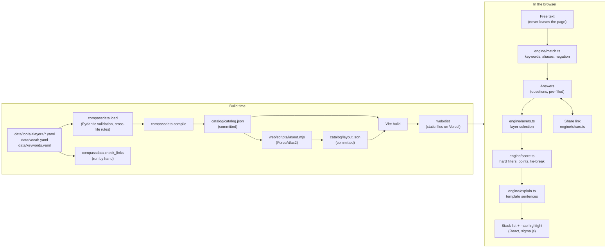

# Stack Compass

Stack Compass recommends a full stack for the project you describe: one tool per layer your project needs (backend, database, auth, payments, hosting and so on), each with the reason it won, the close tools it beat and what to watch for. The answer lights up as a path on an interactive map of 302 tools across 22 layers, which you can also browse on its own. Everything runs in your browser from a hand-checked catalog. There is no backend and no model; the same answers always give the same stack, and a link reproduces it.


## Run it locally

You need Python 3.12 with [uv](https://docs.astral.sh/uv/), and Node 22 with npm.

```sh
uv sync                    # Python data tools
npm --prefix web ci        # web app dependencies
npm --prefix web run dev   # http://localhost:5173
```

Production build: `npm --prefix web run build`, then `npm --prefix web run preview` (http://localhost:4173).

## How it is built



- **Data tools** (Python 3.12, Pydantic v2, PyYAML, httpx, pytest): validate the YAML, compile it to one JSON file, check every link.
- **Site** (Vite, React 19, TypeScript, Tailwind CSS v4, Radix primitives, sigma.js and graphology, Vitest, Testing Library): the map, search, filters, tool panel, table view and the recommender.
- **Hosting**: static files on Vercel (`vercel.json`). No serverless functions.

More detail, including what each part does and what the tests cover: [docs/architecture.md](docs/architecture.md).

## How recommendations work

1. **Describe (optional).** Your text is lowercased and split into words, and phrases from a fixed list of 160 keyword entries are found on word boundaries, longest match first. Tool names and their aliases count too, also inside a longer phrase ("a Flutter app" names Flutter). Only a backend, ORM, API-style or job-queue tool sets a language ("django" means Python); naming any other tool, such as Flutter or React, only marks it as a tool you know. A language you type yourself ("in Swift") always counts. A match with "no", "not", "without", "avoid", "except", "nothing", "don't" or a similar word up to three words before it becomes an exclusion. Filler words such as "want", "to", "use" and "in" are not counted, so "I don't want to use Node" avoids JavaScript and "nothing in Java" avoids Java. The look-back stops at commas, full stops and the words "but" and "however", so "no PHP but Python" avoids PHP and still prefers Python. You see what was picked up as removable chips. The text stays in the page: it is never sent anywhere and never goes into a link.
2. **Questions.** Eight one-click questions, pre-filled from step 1: project type, languages to prefer or avoid, must-have features, hosting, budget, scale, tools you already know, and whether to include dev tooling.
3. **Layers.** The project type sets its core layers (a SaaS gets frontend, meta-framework, UI kit, backend, database, ORM, auth, payments, email, job queue and hosting). Features add layers (file uploads add storage, search adds a search engine), and dev tooling adds CI/CD, observability and testing, plus a state library and a build tool when the stack has a web frontend (a mobile app or an API gets neither). A simple project gets a short list.
4. **Hard filters.** Layers are scored in a fixed order, backend first, so later layers can follow earlier picks. A tool that lists no languages (a hosted service, a database) always passes the language filters. A tool drops out, with the reason shown, when:
   - every language it uses is one you want to avoid (avoiding JavaScript also avoids TypeScript-only tools);
   - you prefer languages and none of them is in a backend, ORM, frontend, meta-framework or mobile tool (on frontend, meta-framework and mobile this applies only when some tool in the layer has a preferred language, so a Python web app still gets a frontend; TypeScript and JavaScript count as one);
   - its hosting does not match yours (managed or self-hosted), shown as "has no official managed service" when you chose managed. Libraries that run inside your app (auth libraries such as Better Auth or Devise, email libraries, in-browser search, in-process caches) are never filtered by hosting: there is no server of their own to host;
   - it is paid only and your budget is free tiers;
   - it shares no language with the backend pick (ORM, API style, job queue) or with the backend or frontend pick (testing);
   - it is an auth library that runs in your app and shares no language with the backend pick (or with the frontend pick when there is no backend), or a hosted auth service with no SDK in the backend or frontend language;
   - it is a meta-framework not built on the frontend pick, or a state library or UI kit that is neither built on nor pairs with it.
5. **Points.** +3 for each feature you asked for that the tool supports, +2 if you already know it, +2 for each earlier pick it pairs with, +1 for an established tool at startup or high-traffic scale, -1 for an emerging tool at high traffic, -2 for a legacy tool.
6. **Ties** go to the tool with more pairs-with links in the catalog, then to the alphabetically first id.
7. **Explanations** are filled-in templates, not generated text: the two biggest score items in plain words plus the tool's first "good for" line, a watch-out from its first "avoid when" line, the full score breakdown, up to two alternatives, and the close tools a hard filter removed with the reason. A layer where nothing fits says "No match" and why.
8. **Share links.** Your answers (never your text) go into the URL query, for example `?t=saas&lp=python&c=payments&h=either&b=any&s=startup&tool=1`. Opening the link recomputes the same stack. Values the link does not recognise are dropped with a notice.

## Data method and sources

- One YAML file per tool in `data/tools/<layer>/`, with its summary, licence, languages, hosting, whether it is a library that runs inside your app, pricing, maturity, what it is good for, when to avoid it, its relations to other tools, a `verified` date and its sources.
- Facts come only from each tool's official site or docs. The `verified` field is the date they were checked. When a fact could not be confirmed, the tool was left out rather than guessed.
- `compassdata.load` rejects the whole catalog, listing every problem with its file, on an unknown tag or layer, a relation to a missing tool, a one-sided "alternative to" or "pairs with" link, an alias two tools share, a keyword phrase that equals a tool name or alias, a duplicate keyword phrase, an overlong summary or a bad date.
- `compassdata.check_links` requests every tool URL, repository and source. A few hosts that refuse automated requests are allowed their known status code (listed in the script).

## Measured numbers

Measured on 2026-11-14 on Windows 11 Pro, Intel Core i7-12700H, 16 GB RAM, Python 3.12.3, Node 22.15. None of these depend on the machine except the link check, which depends on the network that day.

**Catalog size**: 302 tools across 22 layers, 160 keyword entries. Command: `uv run python -m compassdata.stats`

| Layer | Tools | Layer | Tools |
| --- | --- | --- | --- |
| backend | 15 | storage | 14 |
| frontend | 13 | payments | 14 |
| meta-framework | 13 | email | 14 |
| mobile | 12 | cms | 13 |
| database | 13 | state | 12 |
| orm | 18 | ui-kit | 14 |
| api-style | 12 | build-tool | 13 |
| auth | 15 | hosting | 15 |
| cache | 11 | ci-cd | 14 |
| jobs-queue | 14 | observability | 14 |
| search | 13 | testing | 16 |

**Golden set**: 25 of 25 cases pass (100%). Each case is a written project description with checks on the result, for example "backend language is Python", "payments pick is Stripe", "no PHP tool picked". Cases are in `web/src/engine/golden.cases.ts`. Command: `npm --prefix web run golden` (29 tests: the 25 cases plus 4 checks on the set itself).

**Tests**: 50 Python tests (`uv run pytest`) and 283 web tests in 23 files (`npm --prefix web test -- --run`), all passing.

**Links**: 1017 URLs checked, 0 failed. Command: `uv run python -m compassdata.check_links`

## Suggest an edit

Open a tool on the map and choose **Suggest an edit**, or use **Report an issue** in the corner. Both open a pre-filled GitHub issue that asks which fact is wrong and for a link to the official page that says otherwise. To change the data yourself: edit the tool's YAML file, run `uv run python -m compassdata.compile` and `npm --prefix web run layout`, check that `uv run pytest` and `npm --prefix web test -- --run` pass, and open a pull request.

## Limitations

- Keyword matching misses unusual phrasing. If your description says "a place for people to swap sourdough starters", nothing is recognised and the questions do the work.
- The catalog is a curated subset of 302 tools, chosen as mainstream picks plus some notable newcomers. A good tool missing from it can never be recommended.
- Scores are simple sums, and ties are broken by how many pairs-with links a tool has in the catalog, which favours well-connected tools over niche ones.
- There is no live data: no GitHub stars, download counts or latest versions. Facts are as of each tool's `verified` date.
- The map is built for a desktop screen. On a phone it works with pinch and tap, but the table view is easier to read.

## Credit

The map layout and interaction style are inspired by [WhichDB](https://whichdb.dev/), an interactive map of databases. No code, assets or data are taken from it.
