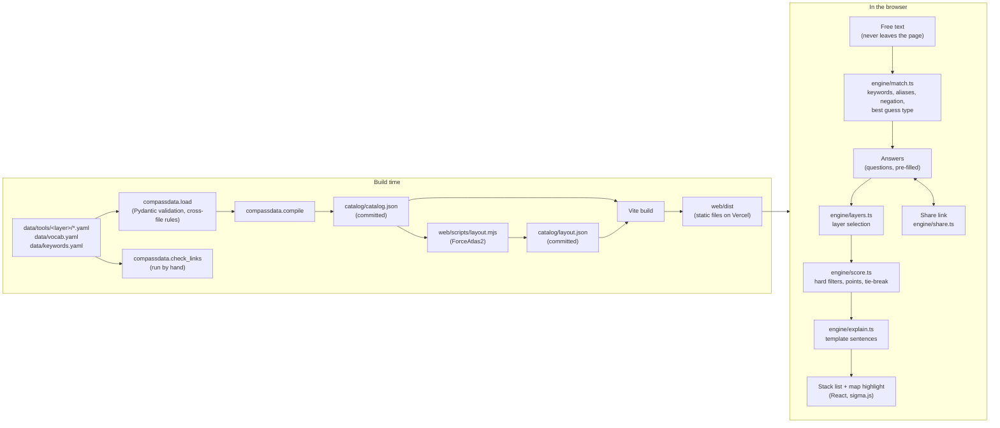

# Architecture

Stack Compass is a static site. All data work happens at build time in Python and Node scripts; all recommendation work happens in the browser. There is no server, no database and no network call after the page loads.

## Pieces

| Part | Where | What it does |
| --- | --- | --- |
| Catalog data | `data/` | One YAML file per tool, plus the vocabulary (languages, capabilities, project types and their layers) and the keyword list. |
| Validator | `tools/compassdata/load.py` | The single place every rule lives: schema, unknown tags and layers, missing or one-sided edges, alias collisions, duplicate phrases, summary length, dates. Reports every error at once, each naming its file. |
| Compiler | `tools/compassdata/compile.py` | Writes `catalog/catalog.json`. `--check` fails CI when the committed file is stale. |
| Link checker | `tools/compassdata/check_links.py` | Requests every tool URL, repo and source. Run by hand before shipping. |
| Stats | `tools/compassdata/stats.py` | Prints tools per layer, the total and the keyword count. |
| Graph layout | `web/scripts/layout.mjs` | Computes dot positions once with ForceAtlas2 so the map is identical on every visit. `--check` fails CI when stale. |
| Engine | `web/src/engine/` | Pure TypeScript: matcher, layer selection, scoring, explanations, share-link encoding. No React, fully unit tested. |
| Map | `web/src/components/graph/` | sigma.js and graphology, loaded in their own chunk after the shell paints. Falls back to the table view without WebGL. |
| Screens | `web/src/components/` | Top bar, search, filters, tool panel, table view, Help me choose sheet. |
| Motion | `web/src/styles/tokens.css`, `web/src/styles/motion.css`, `web/src/lib/motion.ts` | Duration and easing tokens, the CSS classes for sheets, popovers and presses, and the frame loop for the map camera and the pick sequence. Reduced motion sets every duration to 0. |

## Tests

- `uv run pytest`: the validator against fixtures (every rule), the real catalog (valid, fresh, per-layer counts, total), the stats module.
- `npm --prefix web test -- --run`: the engine (every scoring rule, negation, round trips of share links including tampered ones), the golden set of 94 written project descriptions (51 of them plain prompts an owner might type), the screens through Testing Library, the motion helpers (stagger timing, reduced motion), and a scan of `web/src` and `data/` for banned UI patterns and dash characters.
- CI (`.github/workflows/ci.yml`) runs both, plus lint, the catalog and layout freshness checks, and the production build.
